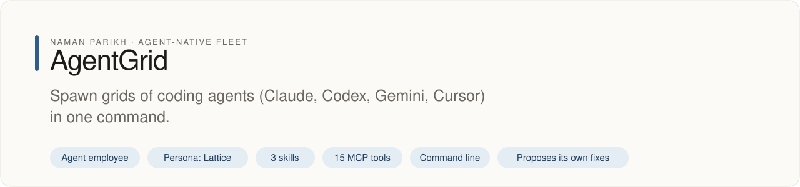

# agentgrid

<!-- fleet:header:start -->
<p align="center"><picture><source media="(prefers-color-scheme: dark)" srcset="assets/banner-dark.svg"></picture></p>

<p align="center">
<a href="https://github.com/naman10parikh/agentgrid/actions/workflows/ci.yml"></a>
<a href="https://github.com/naman10parikh/agentgrid/releases"></a>
<a href="LICENSE"></a>
<a href="#use-it-from-any-coding-agent"></a>
<a href="https://x.com/naman10parikh"></a>
<a href="https://www.linkedin.com/in/naman-parikh1/"></a>
</p>

<p align="center"><a href="#quick-start">Quick start</a> · <a href="docs/README.md">How it works</a> · <a href="AGENTS.md">AGENTS.md</a> · <a href="llms.txt">llms.txt</a> · <a href="skills/">Skills</a> · <a href="https://github.com/naman10parikh/agentgrid/discussions">Discussions</a> · <a href="https://github.com/naman10parikh">All projects</a></p>

**Spawn grids of coding agents (Claude, Codex, Gemini, Cursor) in one command.**

AgentGrid is an agent employee, a packaged specialist agent with its own skills, memory and tests. It owns one job: dispatch. Its persona is Lattice. Coding agents use it through its skills, its MCP server and its command line. A scheduled job runs its evals and proposes fixes. A person makes every change.

_AgentGrid is part of an agent-native play for agent-native systems that can eventually be recursively self-improving and evolving, operated by agent employees._
<!-- fleet:header:end -->

agentgrid splits your terminal into a grid of AI coding agents, one per tmux pane, and shows who is working (blue),
who needs you (yellow) and who is done (green), with sound alerts. It is for anyone who runs several coding agents at
once, and for lead agents that hand work to other agents. It runs on plain tmux with no daemon, and works with
**Claude Code, Codex, Gemini CLI, Aider, Goose, Cline, Hermes, Copilot, Cursor**, or any terminal command.

```
┌──────────────┬──────────────┬──────────────┐
│ ● Agent 1    │ ● Agent 2    │ ● Agent 3    │
│ fixing auth  │ writing tests│ updating docs│
├──────────────┼──────────────┼──────────────┤
│ ✓ Agent 4    │ ◌ Agent 5    │ ● Agent 6    │
│ done · 3min  │ needs input  │ refactoring  │
└──────────────┴──────────────┴──────────────┘
```

<!-- fleet:use:start -->
## Use it from any coding agent

**Claude Code**: the plugin brings the skills, sub-agents, hooks and MCP server.

```
/plugin marketplace add naman10parikh/agentgrid
/plugin install agentgrid@agentgrid
```

<details><summary>Its MCP server, Codex, Cursor, Gemini CLI, one skill and the command line</summary>

**Its MCP server**, in any MCP client:

```bash
claude mcp add --transport stdio agentgrid -- npx -y -p github:naman10parikh/agentgrid agentgrid-mcp
codex mcp add agentgrid -- npx -y -p github:naman10parikh/agentgrid agentgrid-mcp
```

Cursor (`.cursor/mcp.json`), Gemini CLI (`.gemini/settings.json`) and most other clients take the same command as JSON:

```json
{
  "mcpServers": {
    "agentgrid": {
      "command": "npx",
      "args": [
        "-y",
        "-p",
        "github:naman10parikh/agentgrid",
        "agentgrid-mcp"
      ]
    }
  }
}
```

**Gemini CLI**: the extension brings the context and the MCP server.

```bash
gemini extensions install https://github.com/naman10parikh/agentgrid
```

**One skill** (3 in all, in [skills/](skills/)), in any agent that reads Agent Skills:

```bash
gemini skills install https://github.com/naman10parikh/agentgrid --path skills/agentgrid
git clone --depth 1 https://github.com/naman10parikh/agentgrid /tmp/agentgrid && cp -r /tmp/agentgrid/skills/agentgrid ~/.claude/skills/
```

**The command line:**

```bash
npx -y -p github:naman10parikh/agentgrid agentgrid --help
```

</details>

Codex, Cursor, OpenCode, GitHub Copilot and other agents read [AGENTS.md](AGENTS.md); Claude Code reads [CLAUDE.md](CLAUDE.md) and Gemini CLI reads [GEMINI.md](GEMINI.md), which import it. [llms.txt](llms.txt) maps every surface for agents that read first.
<!-- fleet:use:end -->

## Quick start

You need bash, tmux and python3, on macOS, Linux or Windows (WSL). The MCP server and the per-pane commands also need
Node 18 or newer.

### Install

agentgrid is not on the npm registry yet, so it runs and installs from GitHub:

```bash
# Run it straight from GitHub, nothing installed
npx -y -p github:naman10parikh/agentgrid agentgrid --help

# Or keep a copy: clone, build, and put both commands on your PATH
git clone https://github.com/naman10parikh/agentgrid && cd agentgrid && npm install && npm install -g .
```

### Your first grid

```bash
# Inside tmux: a 2x2 grid; the last word is the agent every pane runs
agentgrid 2x2 claude      # or codex, gemini, aider, or any command: agentgrid 2x2 sh

# See every pane, send them all one line, clear the grid
agentgrid status --json
agentgrid broadcast "pull main and run the tests"
agentgrid kill
```

Not inside tmux? agentgrid opens a tmux session for you first. The interactive wizard is `agentgrid setup`, and
`agentgrid launch dev-sprint` starts a saved team layout.

The one-line installer copies the command to `~/.local/bin`, installs tmux if it is missing, adds the presets and a
tmux config, and adds the pane-status hooks to Claude Code's settings:

```bash
curl -fsSL https://raw.githubusercontent.com/naman10parikh/agentgrid/main/install.sh | bash
```

It copies only the shell script and the status script. So the commands that run the TypeScript CLI, such as `send`,
`read`, `inject` and `mcp-serve`, need the clone or `npx` route above. If you add the clone after the installer,
delete `~/.local/bin/agentgrid` so the clone's copy runs.

## How it works

The command line is about 1,440 lines of bash on top of tmux: no daemon, no server, no background process. The
per-pane commands, the MCP server, memory search and the sandbox run from a small TypeScript build in `dist/`. An
optional Electron desktop app lives in `app/`.

1. **Grid engine:** creates tmux panes with `split-window` and `select-layout tiled`.
2. **Status system:** custom tmux options (`@pane_status`, `@pane_label`) hold each pane's state and name.
3. **Agent hooks:** Claude Code hooks call `pane-status.sh` when an agent starts, needs input and stops. The Claude
   Code plugin ships these hooks in [`hooks/hooks.json`](hooks/hooks.json). No other agent sets a status yet.
4. **Sound alerts:** `afplay` (macOS) or `paplay` (Linux), which play through Do Not Disturb and Focus.
5. **Session persistence:** JSON snapshots of the layout, each pane's agent, directory and conversation id.
6. **Agent detection:** walks the process tree (`ps -o args`) to find the agent behind a `node` process.
7. **MCP server:** `agentgrid-mcp` exposes 15 tools, so another coding agent can create, drive and read a grid. Tool
   input goes to the CLI as an argument array, never through a shell.
8. **Run log:** every state-changing command (grid, broadcast, send, inject, kill, sandbox) appends one line to
   `logs/runs.jsonl`; `agentgrid runs` shows them.
9. **Sandbox:** `agentgrid sandbox-run "<command>"` runs a command in a fresh E2B microVM, with your own
   `E2B_API_KEY`. Booting the microVM took a median of 505 ms over nine runs from a laptop (263 to 1,162 ms,
   network included).

### Architecture

```
┌─────────────────────────────────────────────────┐
│                   agentgrid CLI                  │
│  (about 1,440 lines of bash, no daemon/server)   │
├────────────┬────────────┬───────────────────────┤
│  Grid      │  Session   │  Status               │
│  Engine    │  Manager   │  System               │
│            │            │                        │
│  split     │  save      │  @pane_status          │
│  layout    │  restore   │  @pane_label           │
│  equalize  │  presets   │  color-coded           │
├────────────┴────────────┴───────────────────────┤
│                    tmux                          │
│  panes · sessions · custom options · hooks       │
├─────────────────────────────────────────────────┤
│              Terminal Emulator                   │
│  Ghostty · iTerm2 · Kitty · WezTerm · Terminal  │
└─────────────────────────────────────────────────┘
```

## Why agentgrid?

You have 6 tasks. You could run them sequentially in one Claude session (slow), or open 6 terminal tabs manually (tedious). agentgrid gives you:

- **One command** to spawn any grid layout (2x2, 3x5, 5x5)
- **Color-coded status** so you know who needs attention at a glance
- **Sound alerts** when an agent finishes or needs input (works through DND)
- **Save & restore** entire grid configurations with conversation history
- **Few dependencies**: tmux, bash and python3, plus Node 18 for the MCP server and the per-pane commands

## Features

### Grid Layouts

```bash
agentgrid 2x2 claude     # 4 panes
agentgrid 3x4 codex      # 12 panes
agentgrid 5x5            # 25 empty panes (up to 10x10)
```

Panes auto-equalize. Re-equalize anytime: `agentgrid equalize`

### Interactive Setup

```bash
agentgrid setup
```

Visual wizard with grid preview. 4 steps:

1. Grid size → `2x3` or just `6`
2. Default agent → `claude`
3. Configure individual panes (names, agents)
4. Save as preset (optional)

### Status Labels

| Status      | Label      | Color  | Sound |
| ----------- | ---------- | ------ | ----- |
| Working     | ⚡ WORKING | Blue   | none  |
| Needs input | ⏳ WAITING | Yellow | Tink  |
| Done        | ✅ DONE    | Green  | Glass |

Status updates automatically through Claude Code's hooks. agentgrid sets up no hooks for other agents and reads no
exit codes, so their panes show as idle.

### Dashboard

```bash
agentgrid dashboard          # Snapshot with controls
agentgrid dashboard live     # Auto-refreshing every 2s
```

Table view of all panes with name, agent, and status. Quick action menu included.

### Session Save & Restore

```bash
agentgrid save my-grid                    # Save everything
agentgrid restore my-grid                 # Restore + resume conversations
agentgrid restore my-grid --no-start      # Layout only, no agents
```

Save captures each pane's agent, directory, name, and **conversation session ID**. Restore resumes the exact conversation, not just the most recent one.

Per-agent resume: Claude (`--resume <id>`), Codex (`codex resume <id>`), Gemini (`--resume latest`), Goose (`session resume --last`).

### Presets

```bash
agentgrid preset list                     # See saved presets
agentgrid launch dev-sprint               # Launch one
agentgrid preset show mixed-agents        # View details
agentgrid preset delete old-setup         # Remove
```

9 built-in presets ship in `presets/`, from `dev-sprint` (4 panes) and `mixed-agents` (6 panes) to `research-swarm` (9 panes); the `agentgrid-sessions` skill lists them all.

### Broadcast

```bash
agentgrid broadcast "git pull && pnpm test"    # Send to ALL panes
agentgrid broadcast "/status"                  # Send a slash command
```

### Custom Sounds

```bash
agentgrid sound done ~/Music/tada.mp3          # Your own audio
agentgrid sound waiting system:Hero            # macOS built-in
agentgrid sound test                           # Preview all 3
agentgrid sound off                            # Silence
```

MP3, WAV, AIFF, M4A, OGG. Plays through DND/Focus mode via `afplay` (macOS) or `paplay` (Linux).

### Pane Management

```bash
agentgrid name "Auth Worker"         # Name current pane (locked)
agentgrid add right claude           # Add pane to grid
agentgrid swap up                    # Reorder panes
agentgrid equalize                   # Even out sizes
agentgrid kill                       # Clear to 1 pane
agentgrid status                     # All pane statuses
agentgrid status --json              # Machine-readable (for scripts)
```

### Per-pane work

```bash
agentgrid send %3 "Write the tests for src/auth/"   # one prompt to one pane
agentgrid inject %3 --file missions/tests.md        # a long mission file
agentgrid read %3 -n 40                             # the pane's last 40 lines
agentgrid monitor                                   # every pane's status and output, live
```

### Agent Detection & Installation

```bash
agentgrid agents                     # Show installed/available
agentgrid install codex              # Install one
agentgrid install-all                # Install all missing
```

## Supported Agents

| Agent           | Command      | Install                                                                        | Auto Status |
| --------------- | ------------ | ------------------------------------------------------------------------------ | ----------- |
| Claude Code     | `claude`     | `npm install -g @anthropic-ai/claude-code`                                     | Yes (hooks) |
| Codex           | `codex`      | `npm install -g @openai/codex`                                                 | No          |
| Gemini CLI      | `gemini`     | `npm install -g @google/gemini-cli`                                            | No          |
| Aider           | `aider`      | `pip install aider-chat`                                                       | No          |
| OpenCode        | `opencode`   | `npm install -g opencode-ai`                                                   | No          |
| Goose           | `goose`      | `brew install block-goose-cli`                                                 | No          |
| Cline           | `cline`      | `npm install -g cline`                                                         | No          |
| Hermes          | `hermes`     | the vendor's installer: [hermes-agent](https://github.com/NousResearch/hermes-agent) | No          |
| Copilot         | `copilot`    | `npm install -g @github/copilot`                                               | No          |
| Cursor          | `cursor`     | the vendor's installer: [Cursor CLI](https://cursor.com/docs/cli/installation) | No          |
| **Any command** | `<your-cmd>` | none                                                                           | No          |

`agentgrid install <agent>` and `agentgrid install-all` run only the commands above, each checked against its
registry and listed with its source in [install-allowlist.json](install-allowlist.json). For Hermes and Cursor they
print the vendor's page instead, because neither has a package agentgrid could verify.

agentgrid doesn't restrict what you run. Any terminal command works as an agent.

## All Commands

```
GRIDS
  agentgrid ROWSxCOLS [agent]         Create grid (e.g. 2x3 claude)
  agentgrid setup                     Interactive wizard with grid preview

PRESETS
  agentgrid launch <name>             Launch a saved preset
  agentgrid preset list               Show presets
  agentgrid preset show <name>        View details
  agentgrid preset delete <name>      Delete

SESSIONS
  agentgrid save [name]               Save grid + names + conversations
  agentgrid restore [name]            Restore grid + resume chats
  agentgrid restore [name] --no-start Layout only (no agents)

AGENTS
  agentgrid agents                    Detect installed agents
  agentgrid install <agent>           Install one
  agentgrid install-all               Install all missing

CONTROL
  agentgrid dashboard                 Grid map + controls
  agentgrid dashboard live            Auto-refreshing (2s)
  agentgrid status                    All pane statuses
  agentgrid status --json             Machine-readable output
  agentgrid add [right|down] [agent]  Add pane to grid
  agentgrid swap [up|down]            Swap pane position

PANES
  agentgrid name <name>               Name current pane (locked)
  agentgrid broadcast <text>          Send to all panes
  agentgrid equalize                  Even out sizes
  agentgrid kill                      Clear to 1 pane

PER PANE
  agentgrid send <pane> <text>        Send a prompt to one pane
  agentgrid read <pane> [-n N]        Read a pane's recent output
  agentgrid inject <pane> --file F    Inject a long mission file
  agentgrid monitor                   Live monitor with pane output

HARNESS
  agentgrid mcp-serve                 Start the MCP server (stdio)
  agentgrid memory-search "<query>"   BM25 search over memory and docs
  agentgrid sandbox-run [command]     Run a command in an E2B microVM
  agentgrid runs                      Recent run-log entries

SOUNDS
  agentgrid sound                     Show current sounds
  agentgrid sound <event> <file>      Set sound
  agentgrid sound test                Preview all
  agentgrid sound off                 Disable

SETUP
  agentgrid start [session]           Start/attach tmux
  agentgrid terminal-setup            Configure Claude panes
  agentgrid tips                      Usage tips
  agentgrid update                    Self-update from GitHub
  agentgrid detach                    Exit (grid keeps running)
  agentgrid --version                 Show version
  agentgrid --help                    Show help
```

## Keyboard Shortcuts

| Keys               | Action                      |
| ------------------ | --------------------------- |
| **Option+H/J/K/L** | Navigate panes (vim-style)  |
| **Option+Arrow**   | Navigate panes              |
| **Click**          | Switch to pane              |
| **Ctrl+A \|**      | Split right                 |
| **Ctrl+A -**       | Split down                  |
| **Ctrl+A z**       | Zoom (fullscreen toggle)    |
| **Ctrl+A E**       | Equalize sizes              |
| **Ctrl+A { }**     | Swap pane up/down           |
| **Ctrl+A Space**   | Cycle layouts               |
| **Ctrl+A c**       | New window                  |
| **Ctrl+A 1-9**     | Switch window               |
| **Ctrl+A d**       | Detach (runs in background) |
| **Drag borders**   | Resize panes with mouse     |

## Configuration

```
~/.agentgrid/
├── config.json          # Global settings (sounds, defaults)
├── presets/             # Saved grid configurations
│   ├── dev-sprint.json
│   ├── mixed-agents.json
│   └── research-swarm.json
├── sessions/            # Saved session state (save/restore)
└── sounds/              # Custom sound files
```

Example `config.json`:

```json
{
  "default_agent": "claude",
  "sounds": {
    "done": "/System/Library/Sounds/Glass.aiff",
    "waiting": "/System/Library/Sounds/Tink.aiff",
    "sub_agent": "/System/Library/Sounds/Purr.aiff"
  }
}
```

## Works With

**Terminals:** Ghostty, iTerm2, Terminal.app, Kitty, WezTerm, Alacritty, Windows Terminal (WSL)

**IDEs:** Cursor (integrated terminal), VS Code (integrated terminal)

**OS:** macOS, Linux (Ubuntu, Fedora, Arch), Windows (via WSL)

## FAQ

**Q: Do I need tmux installed?**
A: agentgrid installs tmux automatically if it's missing (via Homebrew on macOS, apt/dnf/pacman on Linux).

**Q: Can I mix different agents in the same grid?**
A: Yes. Use `agentgrid setup` to assign different agents per pane, or start with a uniform grid and override individual panes.

**Q: What happens when I close my terminal?**
A: The tmux session keeps running in the background. Reattach with `agentgrid start` or `tmux attach`.

**Q: Can I use this with my own CLI tool?**
A: Yes. Any command works: `agentgrid 2x2 "python my_agent.py"`. agentgrid doesn't restrict what runs in each pane.

**Q: How does save/restore work with conversations?**
A: `agentgrid save` captures each pane's conversation session ID by walking the process tree. `agentgrid restore` uses agent-specific resume flags (`--resume` for Claude, `codex resume` for Codex, etc.) to pick up where you left off.

**Q: What's the maximum grid size?**
A: 10x10 (100 panes). In practice, 3x3 or 4x4 is the sweet spot for most monitors.

**Q: Does it work in VS Code / Cursor terminal?**
A: Yes. The integrated terminal supports tmux. Run `agentgrid 2x2 claude` directly.

## Tests and evals

```bash
bash test.sh     # 30+ smoke checks: files, versions, help output, presets, security
pnpm test        # 48 vitest tests of the TypeScript CLI
pnpm eval        # smoke, 44 surface checks, and 7 golden tasks run 3 times on a private tmux server
```

The golden tasks drive the real CLI, the MCP server and the plugin hooks: spawn a 2x2 grid, list it as JSON, broadcast
to every pane, color a pane through the hooks, read status and send to one pane over MCP, clear the grid, and find
every action in the run log. CI runs the tests and the evals on every push and pull request.

The self-improvement loop (`.github/workflows/improve.yml`, nightly) runs the same evals, then compares the live
command list and MCP tools with the docs, skills and memory, and writes what to improve to the run summary. It needs
no secret and never pushes or merges.

## See Also

- **[agentbench](https://github.com/naman10parikh/agentbench)**: Lighthouse for coding-agent harnesses: score your setup out of 100
- **[agentmoney](https://github.com/naman10parikh/agentmoney)**: know what your AI costs: pricing and spend for Claude, GPT and Gemini
- **[claude-harness](https://github.com/naman10parikh/claude-harness)**: a production-grade Claude Code setup with hooks, skills and memory

<!-- fleet:anatomy:start -->
## What it is made of

Every project in this fleet is graded on the same 11 harness components and on self-improvement. Each mark is backed by a file you can open.

| Component | Grade | Where |
| --- | --- | --- |
| Identity | ✅ | identity/SOUL.md:1 (Lattice; BRAND, HEARTBEAT, bootstrap MEMORY, no template slots) |
| Memory | ✅ | memory/MEMORY.md:1 (about 785 tokens) + BM25 index src/lib/memory-index.ts:47 (agentgrid memory-search) + memory/LEARNINGS.md (7 rules) |
| Skills | ✅ | skills/agentgrid/SKILL.md:1, skills/agentgrid-orchestrate/SKILL.md:1, skills/agentgrid-sessions/SKILL.md:1 |
| Tools/CLIs | ✅ | package.json:7 (bins agentgrid, agentgrid-mcp); agentgrid:1459 (--version) |
| Hooks | ✅ | .claude/settings.json:4 (SessionStart, PostToolUse) + hooks/hooks.json:4 (plugin pane-status hooks) |
| Sub-agents | ✅ | .claude/agents/grid-operator.md:1, .claude/agents/pane-doctor.md:1 (flat, bundled in .claude-plugin/plugin.json) |
| MCPs | ✅ | src/mcp-server.ts:36 (own stdio server, 15 tools; bin agentgrid-mcp) + .mcp.json:3 |
| Dispatch | ✅ | agentgrid:261 (grid) and agentgrid:1132 (broadcast); scheduled run .github/workflows/improve.yml:9 |
| Evals | ✅ | eval/run.sh:1 (smoke, surfaces 44, golden 7 tasks pass^3) gating CI .github/workflows/test.yml:45 |
| Observability | ✅ | src/lib/run-log.ts:52 + agentgrid:156 (append-only logs/runs.jsonl) + .claude/hooks/audit-log.sh |
| Sandbox/Infra | ✅ | src/commands/sandbox.ts:52 (E2B microVM, e2b dependency package.json:75) |
| Self-improvement | ✅ | dsip.json:1 (L2) + .github/workflows/improve.yml (nightly loop) + scripts/improve.mjs |

✅ real and tested · 🟡 partial, with the reason in the row · ❌ absent
<!-- fleet:anatomy:end -->

<!-- fleet:footer:start -->
## How it improves itself

It carries its own evals and a self-improvement contract, [`dsip.json`](dsip.json), which says what it may change and how a change is judged. A scheduled job runs its evals and proposes fixes. A person makes every change. Lessons it learns are kept as rules in its memory files.

## Part of a fleet

One of the projects by [Naman Parikh](https://github.com/naman10parikh). Each owns one part of an agent's harness, or of the product around an agent, and all of them follow one standard.

| Related project | What it owns |
| --- | --- |
| [AgentDial](https://github.com/naman10parikh/agentdial) | Identity |
| [WikiMem](https://github.com/naman10parikh/wikimem) | Memory |
| [Skillsmith](https://github.com/naman10parikh/skillsmith) | Skills |
| [Agent Booster](https://github.com/naman10parikh/agent-booster) | Tools / CLIs |
| [Armory](https://github.com/naman10parikh/armory) | MCPs and the component registry |
| [AgentSwarm](https://github.com/naman10parikh/agentswarm) | Dispatch |
| [AgentBench](https://github.com/naman10parikh/agentbench) | Evals |
| [AgentMoney](https://github.com/naman10parikh/agentmoney) | Observability |
| [Claude Harness](https://github.com/naman10parikh/claude-harness) | The whole harness, as a template |

## Community

Questions and ideas go to [Discussions](https://github.com/naman10parikh/agentgrid/discussions); bugs go to [issues](https://github.com/naman10parikh/agentgrid/issues/new/choose). Follow the work on [X](https://x.com/naman10parikh) and [LinkedIn](https://www.linkedin.com/in/naman-parikh1/).

## Contributing and security

Read [CONTRIBUTING.md](CONTRIBUTING.md). AI-assisted pull requests are welcome. Report a vulnerability privately, as [SECURITY.md](SECURITY.md) explains.

## Star history

If it is useful to you, a star helps other people find it.

<a href="https://star-history.com/#naman10parikh/agentgrid&Date"><picture><source media="(prefers-color-scheme: dark)" srcset="https://api.star-history.com/svg?repos=naman10parikh/agentgrid&type=Date&theme=dark"></picture></a>

## Contributors

<a href="https://github.com/naman10parikh/agentgrid/graphs/contributors"></a>
<!-- fleet:footer:end -->


## License

MIT, see [LICENSE](LICENSE).
