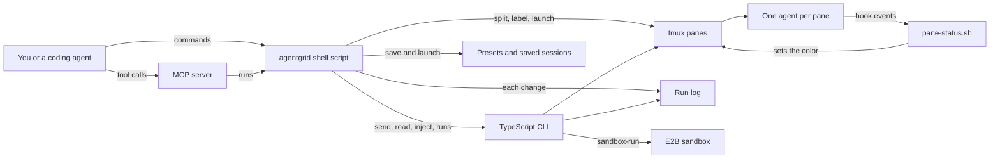

# How AgentGrid works

AgentGrid puts several AI coding agents side by side in one terminal window, one agent per pane.
It is built on tmux, a terminal multiplexer that splits one window into panes.
It names each pane, starts your agent in it, and colors the pane border by status.
Then you can send work to one pane or to all of them, and save the layout for later.
It is for people and coding agents who run several agent sessions at once.

> Spawn a grid of AI coding agents in one command.

```bash
agentgrid 2x3 claude    # 6 Claude Code instances, evenly tiled
agentgrid 3x3 codex     # 9 Codex instances
agentgrid setup          # Interactive wizard — 3 questions, done
```

agentgrid creates grids of terminal panes, runs your agent in each one, and shows you which are done (green), need input (yellow), or working (blue) — with sound alerts.

Works with **Claude Code**, **Codex**, **Gemini CLI**, **Aider**, **Goose**, **Cline**, **Hermes**, **Copilot**, **Cursor**, or any terminal command.

## The parts



The command you type is [agentgrid](../agentgrid), a Bash script.
It creates grids, runs the setup wizard, launches presets, saves and restores sessions, and prints status.
It hands `send`, `read`, `inject`, `monitor`, `logs`, `memory-search`, `sandbox-run`, `runs`, `mcp-serve`, `harness`, `init` and `generate` to the TypeScript CLI in [src/index.ts](../src/index.ts).
That CLI is built to `dist/index.js`, and its commands live in [src/commands/](../src/commands/).
[src/mcp-server.ts](../src/mcp-server.ts) offers 15 tools, such as `grid_create` and `pane_send`, over MCP, the Model Context Protocol that agents use to call tools.
Each tool calls the `agentgrid` command, or tmux itself, with its arguments as a list, so no shell ever reads the text.
Presets in [presets/](../presets/) are JSON lists of pane names and agent commands.
Grids, broadcasts, kills, sends, injects and sandbox runs each add a line to the run log, `logs/runs.jsonl`.
`sandbox-run` runs one command in an E2B sandbox, a short-lived virtual machine.

Each pane carries two tmux options: `@pane_label` for its name and `@pane_status` for its state.
[pane-status.sh](../pane-status.sh) sets the state to running, needs-input or done.
Claude Code calls it through hooks, which are commands it runs at set moments.
The plugin's [hooks/hooks.json](../hooks/hooks.json) marks a pane running when you submit a prompt, needs-input on a notification, and done when the agent stops.
The plugin in [.claude-plugin/](../.claude-plugin/) also brings three skills in [skills/](../skills/) and two sub-agents, grid-operator and pane-doctor.
[install.sh](../install.sh) writes similar hooks into `~/.claude/settings.json`, where a permission request marks needs-input.
Its hooks also play a sound for waiting and for done.
It appends a block to `~/.tmux.conf` with Ctrl+A as the prefix key, mouse support and a colored border.
The border shows WORKING in blue, WAITING in yellow and DONE in green.

## What happens when you run it

The main flow is `agentgrid 2x3 claude`, then `agentgrid status`.

1. [agentgrid](../agentgrid) sees a size such as `2x3` as the first word and calls `cmd_grid`.
2. If you are not inside tmux, it opens the tmux session named `agentgrid`, or attaches to it, and stops there. Run the command again inside that session. `AGENTGRID_SESSION` changes the name.
3. It checks that the size is between 1x1 and 10x10.
4. If the agent command is missing, it asks to install it from a fixed list of checked packages. For Hermes and Cursor, it shows the vendor's install page and runs nothing.
5. It splits the current window into rows times columns panes. Up to three panes sit in one even row or column, and more are tiled.
6. It labels the panes "Agent 1", "Agent 2" and so on, and clears their status.
7. It types the agent command into every pane. For `claude`, it adds `--effort max` unless you set an effort yourself.
8. It adds a line to the run log and prints the pane count.
9. As each agent works, its hooks call [pane-status.sh](../pane-status.sh), and the pane border changes color.
10. `agentgrid status` lists every pane as working, waiting, done or idle. With `--json`, it prints the same list as JSON.

To hand out work, `agentgrid send <pane> <text>` types into one pane, through [src/commands/send.ts](../src/commands/send.ts).
`agentgrid inject <pane> --file <path>` sends a long prompt. Over 500 characters, it pastes the text through a tmux buffer.
`agentgrid broadcast <text>` types the same text into every pane of the current window.
`agentgrid save <name>` records each pane's label, command, folder and status in `~/.agentgrid/sessions/`. It also looks up each agent's chat session.
`agentgrid restore <name>` rebuilds the grid and resumes each chat where the agent allows it, as Claude Code, Codex, Gemini CLI and Goose do.

## Extending it

- **A new agent.** Add its name to `KNOWN_AGENTS` in [agentgrid](../agentgrid) and in [src/lib/constants.ts](../src/lib/constants.ts). Give it an install command or a vendor page in both files. List the command and its source in [install-allowlist.json](../install-allowlist.json). [src/\_\_tests\_\_/install-allowlist.test.ts](../src/__tests__/install-allowlist.test.ts) fails when these disagree.
- **A new TypeScript command.** Add a file to [src/commands/](../src/commands/) and a `program.command` block to [src/index.ts](../src/index.ts). Then add its name to the pass-through list near the end of [agentgrid](../agentgrid). Without that, the shell script reports an unknown command.
- **A new MCP tool.** Add it to the tool list and to `handleToolCall` in [src/mcp-server.ts](../src/mcp-server.ts). Add a call to the golden tasks in [eval/golden.sh](../eval/golden.sh). Name it in a skill under [skills/](../skills/), because the nightly loop flags any tool that no skill mentions.
- **A new preset.** Add a JSON file to [presets/](../presets/) with a `description` and a list of `panes`, each with a `name` and an `agent`. [install.sh](../install.sh) copies presets into `~/.agentgrid/presets/`, where `agentgrid launch <name>` reads them.
- **A new status.** [pane-status.sh](../pane-status.sh) accepts only running, needs-input and done. A new state needs a value there and a color in the border format in [install.sh](../install.sh).

Then run `pnpm build`, `pnpm test` and `pnpm eval`.
CI also runs the older shell suite, [test.sh](../test.sh), on Linux and macOS.

## Questions

**Does it need an API key or cost money?**
AgentGrid is free and MIT licensed.
Grids, status, presets, sessions, memory search and the MCP server call no model and need no key.
The agents in the panes use their own accounts, and those may cost money.
`sandbox-run` needs `E2B_API_KEY`, and E2B is a paid service.

**Does any data leave the machine?**
AgentGrid itself works with tmux and local files.
Each agent in a pane talks to its own provider as usual.
`sandbox-run` sends one command to an E2B sandbox and deletes the sandbox afterwards.
`agentgrid update` downloads the latest script from GitHub, and so does the install script when it runs from the web.
Installing an agent downloads it from npm, PyPI or Homebrew.
Presets, saved sessions and settings stay in `~/.agentgrid/`.

**How does it improve itself?**
[dsip.json](../dsip.json) describes it as level 2.
On every push and pull request to main, [.github/workflows/test.yml](../.github/workflows/test.yml) runs the build, the tests and the evals.
Every night, [.github/workflows/improve.yml](../.github/workflows/improve.yml) runs [scripts/improve.mjs](../scripts/improve.mjs).
It runs the evals and reads every CLI command and MCP tool.
It proposes docs for any command or tool the docs never mention, and a skill for any tool no skill teaches.
It checks the memory budget and compares the eval time with [eval/baseline.json](../eval/baseline.json).
It writes `logs/proposal.md`, calls no model and never commits, so a person makes every change.
The workflow then opens one issue labelled `proposal`, or updates the one already open, so a person can review it.
It is not level 3, because the loop does not change its own checks.

**How do I run its tests or evals?**
Run `pnpm install` and `pnpm build`.
`pnpm test` runs the Vitest suite in [src/\_\_tests\_\_/](../src/__tests__/).
`pnpm eval` runs [eval/run.sh](../eval/run.sh): a smoke test of the built CLI, a check of every install surface, and the golden tasks.
The golden tasks in [eval/golden.sh](../eval/golden.sh) drive the real script, the MCP server and the plugin hook on a private tmux server.
Your own tmux sessions are never touched.
The whole set must pass three rounds in a row, and `AG_EVAL_K=1` runs one round.
The evals need tmux, Python 3 and Node.

**What does it not do?**
It does not run the agents itself. It types their commands into tmux panes.
Only Claude Code updates the pane colors. The hooks are written for Claude Code, and no code reads other agents' exit codes.
So the status column in the Supported Agents table further down is not set for the other agents.
It is not on the npm registry yet, so `npm install -g agentgrid` fails today.
The install script copies only the shell script and the status script. So the commands it hands to the TypeScript CLI need a built clone.
The `harness`, `init` and `generate` commands write and show harness and settings files, but no grid command reads those files yet. So `agentgrid --help` leaves them out.

## Why agentgrid?

Running multiple AI coding agents means juggling tmux splits, remembering pane IDs, and manually checking which agents finished. agentgrid solves this:

- **One command** to create any grid layout (2x2 to 10x10)
- **Visual status** — colored borders show working/waiting/done at a glance
- **Sound alerts** — hear when agents finish or need input (works through DND)
- **Session save/restore** — pick up exactly where you left off, including conversation history
- **Presets** — save grid configurations and reuse them
- **Any agent** — not locked to one vendor. Use Claude, Codex, Gemini, or literally any CLI command

## Install

```bash
curl -fsSL https://raw.githubusercontent.com/naman10parikh/agentgrid/main/install.sh | bash
```

One command. Installs tmux (if needed), configures everything, sets up agent hooks. 60 seconds.

**Supports:** macOS (Homebrew), Linux (apt/dnf/pacman), Windows (WSL)

**Or via npm:**

```bash
npm install -g agentgrid
```

The package is not on the npm registry yet, so this command fails today. Use the install script above.

## Quick Start

```bash
# Option 1: Quick grid — same agent in every pane
agentgrid 2x3 claude

# Option 2: Interactive setup — pick agents per pane
agentgrid setup

# Option 3: Launch a saved preset
agentgrid launch dev-sprint
```

agentgrid auto-detects if you're in tmux. If not, it launches tmux for you. No manual setup needed.

## How It Works

agentgrid is built on tmux. No daemon, no server, no Electron.

1. Creates tmux sessions with grid layouts (`select-layout tiled`)
2. Labels panes with `@pane_status` and `@pane_label` custom tmux options
3. Installs Claude Code hooks that update status on start/stop/input-needed
4. Plays sounds via `afplay` (macOS) or `paplay` (Linux) — bypasses DND
5. Locks pane names using `allow-rename off` + custom `@pane_label`

## Supported Agents

| Agent           | Command      | Install                              | Auto Status |
| --------------- | ------------ | ------------------------------------ | ----------- |
| Claude Code     | `claude`     | Built-in                             | Yes (hooks) |
| Codex           | `codex`      | `npm install -g @openai/codex`       | Yes (hooks) |
| Gemini CLI      | `gemini`     | `npm install -g @google/gemini-cli`  | Exit code   |
| Aider           | `aider`      | `pip install aider-chat`             | Exit code   |
| OpenCode        | `opencode`   | `npm install -g opencode-ai`         | Exit code   |
| Goose           | `goose`      | `brew install block-goose-cli`       | Exit code   |
| Cline           | `cline`      | `npm install -g cline`               | Exit code   |
| Hermes          | `hermes`     | [vendor installer](https://github.com/NousResearch/hermes-agent) | Exit code   |
| Copilot         | `copilot`    | `npm install -g @github/copilot`     | Exit code   |
| Cursor          | `cursor`     | [vendor installer](https://cursor.com/docs/cli/installation) | Exit code   |
| **Any command** | `<your-cmd>` | none                                 | Exit code   |

Custom agents: use literally any terminal command. agentgrid doesn't restrict what you run.

## Works With

**Terminals:** Ghostty, iTerm2, Terminal.app, Kitty, WezTerm, Alacritty, Windows Terminal (WSL)

**IDEs:** Cursor (integrated terminal), VS Code (integrated terminal)

**OS:** macOS, Linux (Ubuntu, Fedora, Arch), Windows (via WSL)

## Next Steps

- [User Guide](guide.md) — every command explained with examples
- [Presets](presets.md) — save, load, and create custom grid configurations
- [Tips & Tricks](tips.md) — power user shortcuts and integration patterns

## More

- [CLI-REFERENCE.md](CLI-REFERENCE.md): every command and its options.
- [FAQ.md](FAQ.md): common questions about the command-line tool and the desktop app.
- [HARNESS-GUIDE.md](HARNESS-GUIDE.md): how to write a harness, a YAML file that describes a team of agents and its grid.
- [COMPARISON.md](COMPARISON.md): how AgentGrid compares with other multi-agent coding tools.
- [APP-USER-GUIDE.md](APP-USER-GUIDE.md): how to use the desktop app, a separate Electron project in [app/](../app/).
- [ARCHITECTURE.md](ARCHITECTURE.md): how the desktop app is built.
- [IPC-PROTOCOL.md](IPC-PROTOCOL.md): the messages between the desktop app's processes.
- [EXTENSION-GUIDE.md](EXTENSION-GUIDE.md): the desktop app's JSON-RPC socket, which outside tools use to control grids.
- [extensions.md](extensions.md): how to build extensions with custom commands, views, menus and keybindings.
- [COLLABORATOR-ANALYSIS.md](COLLABORATOR-ANALYSIS.md): a research report on another multi-agent desktop app.
- [LAUNCH-BLOG.md](LAUNCH-BLOG.md), [HN-POST.md](HN-POST.md) and [X-THREAD.md](X-THREAD.md): launch drafts for a blog, Hacker News and X.
- [screenshots/](screenshots/): a folder for the docs' images, empty for now.
- [index.html](index.html) and [\_sidebar.md](_sidebar.md): the docsify setup that serves this folder as a docs site.
